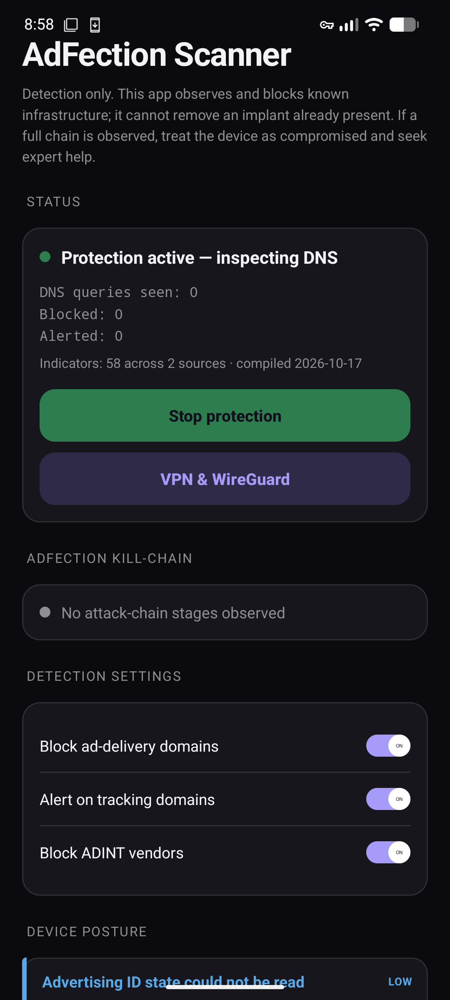
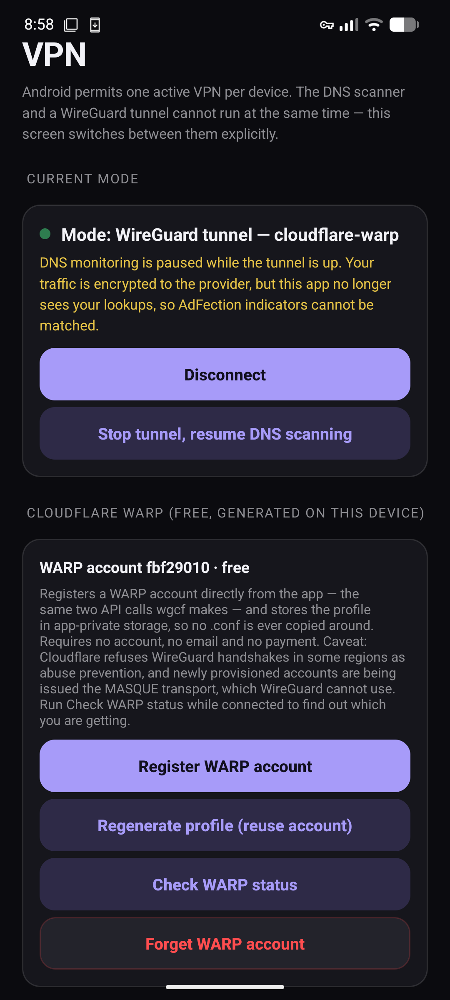
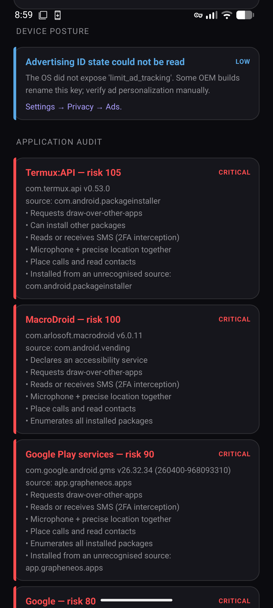

# AdFection Scanner (Android)

<p align="center">
  
</p>

<p align="center">
  <b>On-device detector for advertising-delivered zero-click spyware.</b><br>
  <sub>AdFection / Discover-Tech / Candiru — Citizen Lab Report 195, October 2026</sub>
</p>

<p align="center">
  
  
  
  
</p>

---

An on-device **detector** for the advertising-delivered zero-click spyware chain documented by
Citizen Lab as *AdFection* (Report 195, 15 Oct 2026), plus the surrounding ad-intelligence
(ADINT) infrastructure.

This is a defensive triage tool for journalists, researchers and at-risk individuals — the
population Citizen Lab identifies as the primary target of this campaign.

## Screenshots

<p align="center">
  
  &nbsp;
  
  &nbsp;
  
</p>

<p align="center">
  <sub>Main console · VPN and WARP · Application audit &nbsp;—&nbsp;
  <a href="docs/screenshots">all six screenshots</a></sub>
</p>

> **Note on the audit screenshots:** the application audit ranks by permission breadth, so a
> terminal emulator or a developer tool can score higher than an actual implant. Treat the ranking
> as "worth inspecting", not as a verdict. See [Reading the app audit](#reading-the-app-audit).

## What it detects

| Layer | What is checked | Where |
|---|---|---|
| DNS sinkhole | Every system-resolver lookup is matched against the bundled indicator set and blocked or logged | `net/AdfectionVpnService.kt` |
| Threat alerts | A finding at HIGH or above raises an OS notification, so a detection is seen without opening the app | `net/AlertNotifier.kt` |
| Kill-chain | Ordered sequence *ad infra → Candiru validator → Candiru C2* within a 10-minute window | `engine/ChainDetector.kt` |
| Device posture | Advertising ID, accessibility services, overlay permission, ADB/developer options, update policy, VPN blind spot, battery optimisation, reboot survival | `scan/PostureScanner.kt` |
| Application audit | Permission combinations, install source, background-only services, debuggable builds, APK hashes | `scan/PackageScanner.kt` |
| Report export | Timeline, matched hosts with provenance, posture findings and app audit as a shareable file | `ui/ReportBuilder.kt` |

### Alerts, and what deliberately does not alert

A background monitor that only writes to a log the user has to remember to open is a forensic tool,
not a detector. Any finding at **[HIGH]** or above raises a system notification naming the host.

Ad-delivery and tracking domains are **never** notified, even though they are blocked and logged.
They are routine traffic — a browser touches them constantly — and alerting on them would train the
user to dismiss notifications, which is worse than staying quiet. Notification permission being
denied does not stop the service; it only makes the alerts silent, and the posture audit says so.

### Indicator freshness is reported, not assumed

`iocs.tsv` carries a `Compiled:` date in its header, and the UI states the age. Past 30 days the set
is labelled stale in as many words, because a list that stopped matching is worse than no list: a
clean log then reads as evidence of safety. An **undated** set is also reported as stale — without a
date there is no way to show the list is current, and `IndicatorFreshnessTest` pins that behaviour.


### Why the kill-chain detector matters

Any single indicator match is weak evidence. `mtrtb.com` is an ad domain; a CloudFront hostname can
be rotated; a device may simply have been profiled and never infected. What is *actually*
distinctive is the **ordered sequence on one device inside a short window** — that is the exact
timing signature Citizen Lab reconstructed from Al Jazeera's network logs (report §2):

```
ad impression  →  Candiru validator  →  Candiru C2
```

The app reports each stage as it is seen (1/3, 2/3) and raises a single critical alert at 3/3.

## The one-VPN constraint (why the scanner can appear to "not work")

Android permits **exactly one active VPN per user/profile** — starting a new one stops the old one
([VPN guide](https://developer.android.com/develop/connectivity/vpn)). Two consequences:

### 1. Another VPN app displaces the scanner

If any other VPN app is running (or is set as always-on), it takes the slot and this scanner's
service is stopped. The tunnel silently disappears, lookups stop being inspected, and the app looks
broken. The posture audit reports this as `vpn_blind_spot`, and the status line shows protection as
inactive.

### 2. Private DNS (DNS-over-TLS) bypasses the tunnel entirely

This is the most common cause of "I started it and it found nothing". When a Private DNS hostname
is configured, Android sends DNS over TLS directly to that resolver and **does not** use the
`addDnsServer()` addresses advertised by a VPN. No query ever reaches our tun interface, so the IOC
matcher correctly sees zero traffic.

The posture audit now raises this as a **CRITICAL** finding (`private_dns_bypass`), naming the
configured resolver and telling the user to set Private DNS to **Off** while scanning. This check
is the reason the scanner can sit silent and healthy at the same time.

## Two mutually exclusive modes

Because the constraint cannot be worked around, the app exposes both and states the trade-off in
the UI rather than pretending:

| Mode | DNS / AdFection monitoring | Encrypted to a VPN gateway |
|---|---|---|
| **Scanner** (default) | yes | no |
| **WireGuard tunnel** | no | yes |

The VPN screen switches between them explicitly, waiting for the system to release the slot before
binding the next service. In tunnel mode the app warns in-line that lookups are no longer being
matched. Set `DNS = ` in your profile so lookups still go through the provider over the encrypted
tunnel — that protects the network, but not this app's local IOC matching.

## WireGuard support

The app embeds the **official WireGuard for Android tunnel library**
(`com.wireguard.android:tunnel`, Apache-2.0, WireGuard LLC), which bundles `libwg-go.so` for
`arm64-v8a`, `armeabi-v7a`, `x86` and `x86_64`.

### Cloudflare WARP, registered in the app

WARP is free, needs no account and no payment, and is the one provider whose configuration this app
can generate itself instead of asking the user to fetch a file. The VPN screen performs **the same
two API calls wgcf performs**, and it was verified against the live API rather than assumed:

| Step | Request | Result |
|---|---|---|
| Generate keypair | — | Curve25519 via the bundled WireGuard `KeyPair`; private key never leaves the app |
| Register | `POST /v0a5641/reg` | flat response: `id`, `token`, `account.license`, `account.account_type` |
| Enable | `PATCH /v0a5641/reg/{id}` `{"warp_enabled":true}` | registration leaves this `false`; verified to flip to `true` |
| Fetch config | `GET /v0a5641/reg/{id}` | `config.interface.addresses`, `config.peers[0].public_key`, `endpoint` |
| Build profile | — | wg-quick text, written through the same validation as a hand-imported profile |

The generated profile is stored under the name `cloudflare-warp` in the app's private `files/`
directory. There is no file to copy, no terminal step, and no third party in the path.

**Two API quirks this implementation exists to handle**, both found by reading live responses:

- `endpoint.host` is already `host:port` (`engage.cloudflareclient.com:2408`), so appending
  `ports[0]` produces `host:2408:2408`. The `v4`/`v6` fields in the same object carry a `:0`
  placeholder that *does* need dropping. Treating both the same way has to break one of them — the
  first attempt did, and `WarpProfileTest` caught it via the official parser.
- The register response is a **flat object**, not the `{success, result}` envelope other Cloudflare
  APIs use. Parsing it as the envelope yields silent nulls.

**Check WARP status** reads `https://www.cloudflare.com/cdn-cgi/trace` and reports the `warp` field
(`on` / `plus` / `off`). This is not decoration: it is the only honest test of whether WARP is
actually carrying traffic.

Two limitations of that probe, measured rather than assumed:

- **It only means anything while the tunnel is up.** `warp` describes the *path* a request took, not
  the account: the same host reports `warp=on ip=104.28.220.131` (Cloudflare) through a WARP tunnel
  and `warp=off ip=105.154.82.127` (a national ISP) without one. The app therefore disables the
  button outside tunnel mode and marks a stale result as no longer current.
- **`ip` is the reliable signal; `colo` is not.** `colo` flaps between nearby Cloudflare edges
  (`MAD`↔`LIS`) across consecutive requests, so "which edge" is not a usable indicator of anything.

### On the "WARP+" label

Cloudflare returns `warp_plus: true` for **every** freshly registered free account — verified
directly: `account_type: free`, `warp_plus: true`, `plus_expires_at` absent, `premium_data: 0`. wgcf
prints `account_type`, `premium_data` and `quota` and never `warp_plus` at all. So the flag is not a
subscription indicator, and the app does not render it as one: a WARP+ subscription is claimed only
when `plus_expires_at` is actually present.

### The WARP-over-WireGuard caveat

Registration succeeding does **not** mean the tunnel will carry traffic. Cloudflare refuses
WireGuard handshakes for entire regions and networks as abuse prevention — wgcf's own maintainer
documents this as unsolvable (`ViRb3/wgcf#158`, open since 2022, *"There is no solution to this
problem"*) — and accounts are now being provisioned with `tunnel_protocol: masque`, a transport
WireGuard cannot speak. A device registered from here returned exactly that. That is why the app
ships a status check and says "check which you are getting" rather than promising a working tunnel.

If WARP does not carry traffic for you, the self-hosted and paid providers listed in the app's
provider guidance have no such dependency.

### Where profiles come from

The app is a **client, not a subscription**. For every provider other than the built-in WARP
registration, WireGuard needs an endpoint, a server public key and an address assigned to your
device — those are per-account service credentials, not client software. There is deliberately no
bundled provider: inventing a default endpoint would be a fake default that fails on first use.

Import a `.conf` from a provider you trust, or from your own server:

| Source | Notes |
|---|---|
| **Built-in WARP** | Free, no account. See the caveat above. |
| **Self-hosted** | `wg-easy`, Defguard, or plain `wg-quick` on any VPS. No third party at all — the strongest option for a high-risk user. |
| **Mullvad** | Config generator in the account page. Audited clients, no email required. |
| **Proton VPN** | Has a free tier; WireGuard configs downloadable. |
| **IVPN** | WireGuard configs in the client area. |

Profiles are stored in the app's private `files/` directory, never in shared storage, and are never
uploaded. A profile contains a private key and is treated as a secret: the details dialog
deliberately shows addresses, DNS and endpoint but never the keys.

Import paths: single `.conf` via the file picker, an entire folder of configs at once, or paste the
text. Every import is validated before it is stored — a config that parses but has no `Endpoint`, no
`PrivateKey`, or no `[Peer]` is **rejected**, because that profile would otherwise appear fine and
then fail silently on connect.

## Reading the app audit

The application audit scores installed packages on permission breadth, install source, accessibility
declarations and known-bad indicators. The score is a **sum of risky properties, not a probability of
malware**, and that distinction matters in practice — the bundled screenshots show it clearly:

- A **terminal emulator, ADB wrapper or developer tool** legitimately requests
  `REQUEST_INSTALL_PACKAGES`, draw-over-other-apps and broad storage access. It scores into the red on
  any Android device, because that is what those tools are for.
- **Google Play services** holds nearly every permission in the catalogue by design, and reports an
  unrecognised install source on devices where it is a system app.
- An actual implant usually scores high **and** is sideloaded **and** holds camera + microphone +
  location together, or declares an accessibility service with an innocuous name.

Read three things together, newest install first: the **install source**, the **permission
combination**, and whether you **expected the app to be there**. A red score on something you
installed deliberately is a reminder, not an alarm. A row that is sideloaded *and* holds
surveillance-grade permissions is worth investigating by hand.

## Detection architecture

```
   apps ──┐
          │  DNS query
          ▼
   tun (10.111.222.1:53)          ← only these /32 + /128 routes are captured
          │
          ├─ match BLOCKED? ──► synthesise sinkhole/NXDOMAIN reply
          │
          └─ otherwise ──► protected UDP socket ──► upstream resolver
                                     │
                            reply rewritten and written back to tun
```

Only the virtual DNS addresses are routed into the tunnel. There is **no default route**, so
ordinary traffic never enters the tunnel: no throughput cost, no traffic inspection beyond DNS,
and nothing to leak.

## Indicators

`app/src/main/assets/iocs.tsv` — tab-separated, with provenance on every row:

| Source | Content |
|---|---|
| `CL195` | Discover-Tech / Controlium ad delivery, Candiru validators and C2, ADINT vendors |
| `CONF` | CloudFront payload hosts, SDK command-and-control, tracking domains |
| `VT` | Recovered implant SHA-256 |

Coverage limits are stated in the file header rather than hidden: the published CloudFront hosts
rotate, and Citizen Lab explicitly did not capture the exploit itself.

## Explicit limitations

- **Detection, not remediation.** This cannot remove an implant that is already on the device, and
  it cannot see a compromise that arrived before installation.
- **DNS only.** DNS-over-HTTPS/TLS to a hardcoded resolver, and connections to IP literals, are
  invisible to this monitor. A sophisticated target can therefore bypass it.
- **VPN slot.** Android permits one active VPN. If another VPN is in use, this scanner cannot see
  DNS and the posture report says so.
- **Android 10+.** Below API 29 the app-activity and installer queries degrade.
- **Indicators are a snapshot.** Update `iocs.tsv` as new infrastructure is published.
- **A stored WARP profile can outlive its usefulness.** Registration succeeds even in regions where
  Cloudflare refuses the WireGuard handshake, so a saved profile is not evidence of a working tunnel.
  Only the status check, run with the tunnel up, answers that.

If the kill-chain reaches 2/3 or 3/3, treat the device as compromised and seek expert help — the
app says this in its own UI rather than implying it has "cleaned" anything.

## Build

Requires **JDK 17** and the **Android SDK with platform 35**. No API keys and no network services are
needed to build.

```bash
git clone https://github.com/eyoussef/adfection-scanner.git
cd adfection-scanner

./gradlew :app:assembleDebug      # debug APK
./gradlew :app:testDebugUnitTest  # 108 unit tests
```

Install:

```bash
adb install -r app/build/outputs/apk/debug/app-debug.apk
adb shell am start -n dev.adfection.scanner/.ui.MainActivity
```

### Building on an aarch64 host

The Android Gradle Plugin downloads an x86_64-only `aapt2`. On an ARM host (for example Termux with
PRoot, or an ARM Linux box) point Gradle at the SDK's own binary instead:

```properties
# gradle.properties
android.aapt2FromMavenOverride=/path/to/android-sdk/build-tools/36.0.0/aapt2
```

This is the only host-specific setting in the project; everything else is portable.

### Install constraint in a PRoot sandbox

If you are building inside a Termux/PRoot container, `pm install` will fail. The shell reports
`uid=0` while the Android side runs as `u:r:untrusted_app:s0`, so package installation is refused:

| Path attempted | Result |
|---|---|
| `pm install` | `SecurityException: … asks to run as user -1 but is calling from uid u0a210` |
| `su -c 'pm install'` | Same — PRoot's `su` sets a Linux uid, not an Android one |
| `pm install --user 0` / `cmd package install` | `NullPointerException` in `AppOpsService.checkPackage` |
| `/system/bin/am start` VIEW intent | `SecurityException: package=com.android.shell does not belong to uid=10210` |
| `adb` | `adbd` is not running; no wireless debugging port |
| `/sdcard`, `/data/local/tmp` | Not writable; `/data/adb` absent, no Magisk |

Installing requires one of: `adb` over wireless debugging, a real `su` (Magisk/KernelSU), or a
writable `/data/local/tmp` through an ADB shell. Build and test work fine inside the sandbox; only
the install step does not.

### Verification performed

1. **Unit tests — 108 tests, 0 failures** (`:app:testDebugUnitTest`). These are not smoke tests; they
   caught four real defects during development:
   - `Dns.parseQuery` started name decoding at offset 0 instead of after the 12-byte header;
   - compression-pointer handling allowed self-referential pointers, which would spin a label loop;
   - the forwarder keyed pending queries on the *client's* transaction ID, so two clients using the
     same ID would receive each other's answers. Now the service owns an ID space and restores the
     client's ID on the way back (`ForwarderRoutingTest`);
   - the WARP endpoint builder stripped the port from `engage.cloudflareclient.com:2408`, producing a
     profile the WireGuard parser rejects with "Missing/invalid port number" (`WarpProfileTest`).
2. **APK builds clean** — `:app:assembleDebug`, zero compiler warnings, ~25 MB debug artefact
   (the WireGuard tunnel library bundles `libwg-go.so` for four ABIs).
3. **Indicator asset validated under test** — `iocs.tsv` is parsed by the test suite, which asserts
   every line is well-formed and that matching reaches the expected categories.
4. **Confirmed on a physical device (Pixel 7a, Android 17)** — the WARP registration, the generated
   profile, tunnel activation, the scanner/tunnel handover and the status probe were all exercised by
   the author. The probe reported `WARP: on` with a Cloudflare edge, i.e. traffic genuinely wrapped.
   The screenshots in [docs/screenshots](docs/screenshots) are from that device running this build.

### Manual on-device verification

The app now installs out-of-band on a physical device, so the checks below are for a *second*
install or a regression run rather than a first look. They assume `adb` access.

```bash
# 1. Start the scanner from the UI, then confirm the tunnel exists with only DNS routes:
adb shell dumpsys connectivity | grep -A5 "AdFection"
adb shell ip route show table all | grep 10.111.222

# 2. Prove the block path against an indicator that is in the bundled set:
adb shell nslookup noas.mtrtb.com 10.111.222.1     # expect NXDOMAIN / 0.0.0.0
adb logcat -s AdfectionVpn                          # expect "indicator set loaded: … indicators"

# 3. Prove normal resolution still works (the forwarder path):
adb shell nslookup example.com                     # expect a real answer, not a sinkhole

# 4. Read back the evidence log:
adb shell "run-as dev.adfection.scanner sqlite3 databases/adfection_events.db \
  'SELECT ts,kind,subject,detail FROM events ORDER BY ts DESC LIMIT 20;'"
```

Expected: step 2 produces no address (NXDOMAIN) and a `DNS_BLOCKED` row; step 3 resolves normally.
A full-chain alert fires only if the three stages occur in order — it cannot be produced by a single
`nslookup`, by design.

## Store listing

Listing assets live in the standard `fastlane` layout, so F-Droid and Komoi/IzzyOnDroid can read them
without extra configuration:

```
fastlane/metadata/android/en-US/
├── title.txt                  "AdFection Scanner"
├── short_description.txt      68 characters (F-Droid limit is 80)
├── full_description.txt
└── images/
    ├── icon.png               512 × 512
    └── phoneScreenshots/      ad-screen1..6.png, 1080 × 2400
```

`docs/screenshots/` holds the same screenshots for the README, plus `icon-round.png` for display.
The 512 × 512 icon is generated from the same source artwork as the launcher icon, so the store icon
and the on-device icon cannot drift apart.

### Licence

Apache-2.0. See [LICENSE](LICENSE).

## Layout

```
app/src/main/java/dev/adfection/scanner/
├── data/     Model.kt, IocDatabase.kt, EventStore.kt, Settings.kt
├── engine/   IocMatcher.kt, ChainDetector.kt, TsvIocLoader.kt
├── net/      Dns.kt, Packets.kt, AdfectionVpnService.kt, ScannerState.kt
├── scan/     PostureScanner.kt, PackageScanner.kt
├── ui/       MainActivity.kt, ScannerViewModel.kt, *Adapter.kt
└── vpn/      WireGuardEngine.kt, WireGuardProfiles.kt, WarpClient.kt, WarpAccount.kt,
              VpnActivity.kt, VpnViewModel.kt, ProvidersActivity.kt, Provider.kt
```
